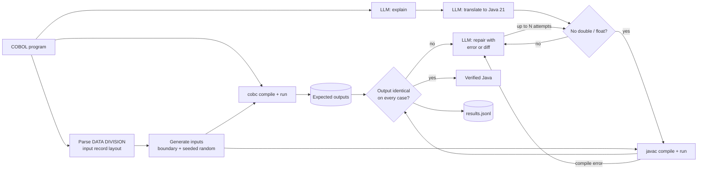

# cobol-bridge

**An LLM translates COBOL to Java; differential testing against the real COBOL compiler proves whether each translation is correct.**

Runs entirely on a laptop: GnuCOBOL and a JDK compile both sides, and IBM's open
Granite models run locally through Ollama. No API keys and no cloud.

<!-- TODO: replace with a GIF of `make demo` -->


## Results

Ten COBOL programs, three local models on an 8 GB Apple M1, up to 3 attempts each
(first try at temperature 0, seed 42). Full tables: [`results/report.md`](results/report.md)
(also as [HTML](results/report.html)).

| | `qwen2.5-coder:7b` | `granite4:micro` (3B) | `granite4:tiny-h` (7B MoE) |
|---|---|---|---|
| **Programs passing, first try** | **0 / 10** | **0 / 10** | **0 / 10** |
| **Programs passing after repair** | **0 / 10** | **0 / 10** | **0 / 10** |
| Final attempt compiles | 9 / 10 | 4 / 10 | 6 / 10 |
| Test cases matched (where it compiled) | 21 / 238 (9%) | 13 / 103 (13%) | 6 / 153 (4%) |
| Repairs that returned the same code | 7 / 20 | 11 / 20 | 10 / 20 |
| Avg LLM time per program | 461 s | 249 s | 141 s |

**No local model under 8 GB produced a single fully correct translation.** That is
the finding, not a bug: every failure is a concrete, logged difference from the
COBOL output. The models got the logic roughly right more often than the format.
Typical diffs from the repair prompts:

```diff
-SUBTOTAL  36,796.64          # COBOL: PIC 9(6)V99 has an implied decimal point
+SUBTOTAL 3,679,664.00        # Java read the digits as a whole number
-YEARS     00                 # COBOL: unedited PIC 99 keeps its leading zero
+YEARS     0
-PRINCIPAL                 0.00   # COBOL: edited fields keep their full width
+PRINCIPAL 0.00
```

The qwen code model wrote Java that compiled far more often (9 of 10) but then failed
on fixed-width output formatting. The Granite models more often failed to compile
(invented APIs, missing imports) or fell back to `double`, which the static check
rejects.

**Repair strategy.** Phase 1 replayed the failing answer as the model's own turn,
and `granite4:micro` returned identical code in 15 of 20 repairs. Phase 2 repairs
in a fresh prompt that quotes the failing code, at temperature 0.4 with a new seed
per attempt. For the same model, repeats fell to 11 of 20, compiling programs rose
from 3 to 4, and matched cases from 0 to 13. The changes were real, but too small to
turn any program into a pass. Both runs are in the report
(`--repair-strategy replay` reproduces Phase 1).

**Fitting on 8 GB.** `granite4:micro` (2.1 GB) and `granite4:tiny-h` (4.4 GB) ran 100%
on the GPU. `qwen2.5-coder:7b` (5.4 GB loaded) ran 85% GPU / 15% CPU, which is why it
is the slowest. `tiny-h` is the fastest because only about 1B of its 7B parameters are
active per token.

Every number above comes from [`results/results.jsonl`](results/results.jsonl) (one
record per program per run) and can be regenerated with `make eval`. The generated
Java, explanations and repair feedback for each attempt are in
[`results/artifacts/`](results/artifacts/).

## How it works



For each program in [`corpus/`](corpus/):

1. **Explain.** The model writes a plain-English summary (data layout, logic, output).
2. **Translate.** The model writes a single-file Java 21 program, given the source, its
   own explanation, the input record layout and a short list of COBOL semantics rules.
3. **Verify.** The COBOL is compiled with `cobc` and the Java with `javac`; both run on
   the same generated inputs, and their outputs must be identical.
4. **Repair.** On a compile error, a floating-point violation, a crash or an output
   mismatch, the model gets the compiler error or a unified diff for the first failing
   input and tries again, up to `--max-attempts` (default 3).
5. **Report.** One JSONL record per program: model, sampling settings, attempts,
   compile status, cases passed, tokens, latency, input and source hashes.

## Quickstart

```bash
brew install uv gnucobol openjdk@21 maven ollama
ollama serve &                 # if Ollama isn't already running
ollama pull granite4:micro
make doctor                    # checks every tool and prints versions
make demo                      # translate + verify one program
make eval                      # the whole corpus; MODEL=granite4:tiny-h to compare
make report                    # results/report.md + report.html
```

`make test` runs the unit tests without Ollama (a scripted fake model drives the loop).

## Design decisions

**Differential testing, not LLM self-assessment.** A translation is correct only if it
produces the same bytes as the original on every test input; the COBOL program
compiled by GnuCOBOL is the oracle. Inputs are derived from the record the program
`ACCEPT`s: every field at zero and at maximum width, signed fields at their most
negative, the smallest unit, both ends of every 88-level `THRU` range and the values
just outside it, every listed 88-level literal plus one that matches none, then 20
seeded random records. A case on which COBOL itself fails is dropped and counted.
The only normalisation is stripping trailing whitespace from each line (COBOL pads
`DISPLAY` fields with spaces); leading and inner spaces, signs, digits and line
counts must match exactly.

**The BigDecimal rule.** COBOL `PIC 9(5)V99` and `COMP-3` are exact decimal fixed point.
Binary `double` cannot represent 0.10 exactly, so any value that passes through it can
come out a cent off. The translation prompt requires `java.math.BigDecimal` with an
explicit scale, `RoundingMode.DOWN` for COBOL's default truncation and `HALF_UP` for
`ROUNDED`. A static check enforces it before compilation: `double`/`float` types,
floating-point literals, `Math.pow`/`round`/... and `doubleValue()` all fail the
attempt and are sent back for repair. The rule is covered by unit tests.

**Local models only.** Everything runs through Ollama's local HTTP API, defaulting to
IBM Granite 4. Temperature is 0 and the seed is fixed, and both are recorded with every
result. The provider interface (`LLMProvider.chat`) is small enough that a hosted
backend could be added without touching the pipeline.

**Process-level isolation, not a sandbox.** Generated code runs natively, through one
module ([`sandbox/runner.py`](src/cobol_bridge/sandbox/runner.py)): a fresh temporary
directory outside the repository that is deleted afterwards, no shell, a minimal
environment (no inherited secrets), a wall-clock timeout that kills the whole process
group, CPU-time and file-size limits, and capped output. This stops accidents (infinite
loops, runaway output, stray files) but it is **not** a security boundary: the code can
still read your files and use the network. That trade-off is acceptable here because
the inputs are a small corpus I wrote and reviewed, the generated programs are short
and use only the JDK, and the models run locally. Running untrusted COBOL or a hosted
model would need a container or VM.

**GnuCOBOL dialect.** Output is compared against GnuCOBOL, whose `DISPLAY` of an
unedited numeric field shows a sign and a decimal point (`PIC S9(3)V99` → `+005.50`),
unlike IBM Enterprise COBOL. The prompt states this, and the exact toolchain versions
are recorded with every result, because formatting can differ between versions.

## Toolchain used for the results

| Tool | Version |
|---|---|
| macOS (Apple M1, 8 GB) | 26.5.1 |
| GnuCOBOL (`cobc`) | 3.2.0 |
| OpenJDK | 21.0.13.1 |
| Maven | 3.10.2 (checked by `make doctor`; not needed by the Phase 1 pipeline) |
| Ollama | 0.40.15 |
| Python / uv | 3.12.15 / 0.13.5 |

CI (GitHub Actions, `ubuntu-latest`) installs GnuCOBOL from apt and Temurin 21, then
runs lint, type checks and the tests, including every corpus program under `cobc`.

## Layout

```
src/cobol_bridge/
  cli.py            translate | eval | report
  llm/              provider interface, Ollama backend, fake backend, prompts
  inputs/           DATA DIVISION parser and test-input generator
  sandbox/          process-isolated compile/run, toolchain discovery
  pipeline/         static checks, output comparison, verification, repair loop
  report/           JSONL storage
corpus/             10 COBOL programs (see corpus/README.md)
results/            results.jsonl and per-attempt artifacts
tests/              unit tests (no Ollama needed)
scripts/doctor.sh   toolchain check
```

## Roadmap

- **Next:** larger models where the hardware allows, few-shot examples of COBOL
  edited-picture formatting in the prompt, and a repair loop that targets the first
  differing line.
- **Phase 3:** file-based I/O programs, copybooks, and a write-up of where models fail.

## License

Apache-2.0. See [LICENSE](LICENSE).
